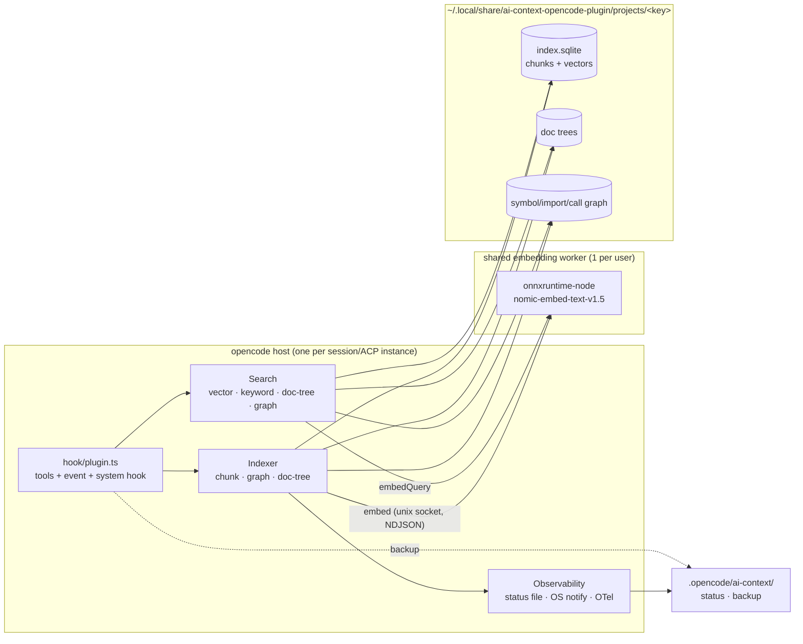
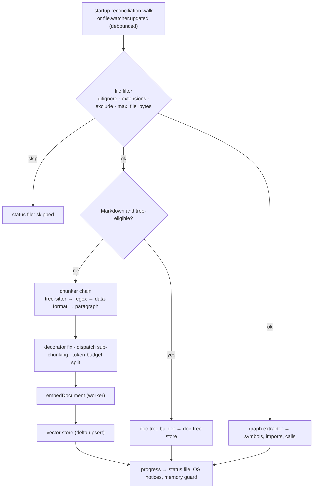
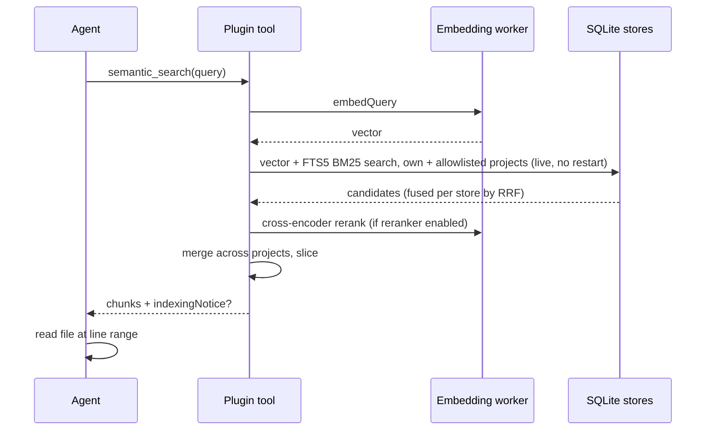
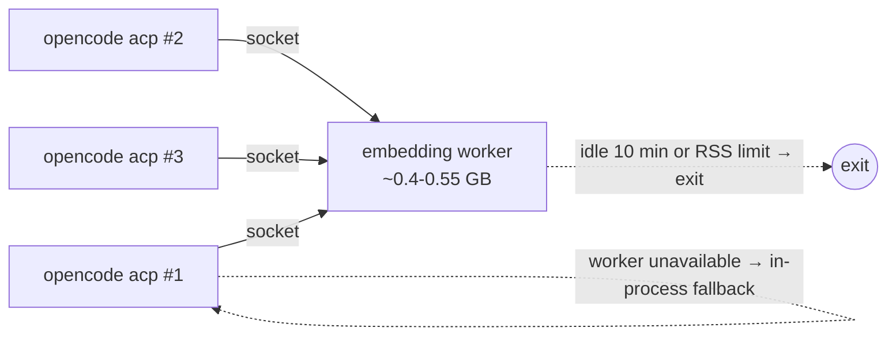

# Architecture

The plugin runs **inside the opencode host process** (Bun, also under ACP in
the JetBrains AI Assistant). The memory-heavy embedding model runs in one
**shared worker process** per user. Everything else is local files.

## Components



## Indexing pipeline



Delta indexing: unchanged files are skipped, removed or newly excluded files
are purged. Failures are skipped with a note (file, error, attempts) instead of
aborting the run.

## Query flow



## Process model



The worker is started on demand by whichever instance needs it first, checked
via a unix socket; a stale socket is replaced. The worker runs up to `embed_concurrency` inferences at once. The first instance's settings apply for the worker's lifetime
([ADR-0021](adr/0021-shared-embedding-worker.md)). The worker runs through
`BUN_BE_BUN=1` using the opencode binary, or `node`/`bun` when available.
The indexer itself still runs in the host; moving it is proposed in
[ADR-0022](adr/0022-indexer-in-worker.md).

## Memory model ([ADR-0019](adr/0019-bounded-memory-during-indexing.md))

| Bound | Mechanism |
| --- | --- |
| Per-text memory | `embed_max_tokens` cap, chunks split to fit |
| CPU | `embed_threads` |
| Big files | `max_file_bytes` skip |
| Host RSS | `max_memory_mb` guard (GC, wait, stop with error) |
| Startup | counts via SQL, no vector loading |
| Search / backup | paged reads (`getChunksPage`) |
| Model | out of the host, in the shared worker |

## Storage layout

- One SQLite file set per project key, derived from the worktree
  ([ADR-0003](adr/0003-per-project-sqlite-file-isolation.md)); physically
  isolated, outside the worktree.
- `bun:sqlite` in opencode, `better-sqlite3` under Node
  ([ADR-0017](adr/0017-bun-sqlite-inside-opencode.md)).
- Brute-force cosine over `Float32` vectors, no ANN
  ([ADR-0002](adr/0002-embedded-sqlite-vector-store-over-postgres-qdrant.md)).
- Backup as sorted JSONL inside the worktree, committable and diffable;
  imported on start when the store is empty
  ([ADR-0007](adr/0007-repo-local-versionable-backup.md)).

## Hooks used

| Hook | Purpose |
| --- | --- |
| `tool` map | registers the tools (2.x: `ctx.tool.transform`; the research tools and `index_status` are direct, the `ai_context_*` tools are Code Mode only) |
| `event` (`file.watcher.updated`, `session.idle`) | debounced re-indexing ([ADR-0012](adr/0012-file-watcher-updated-not-file-edited.md)); 2.x: `ctx.event.subscribe` |
| `experimental.chat.system.transform` | agent hint (2.x: `ctx.session.hook("context")`) |
| `experimental.session.compacting` | keeps code locations found by the context tools (2.x: `compaction` hook) |
| `tool.definition` | grep/glob description suffix (2.x: `editor.update`) |
| `tool.execute.before/after` | telemetry for all tools incl. grep/glob, targeted/full rescan after file-changing tools, search nudge |

The 2.x mapping lives in `hook/v2-plugin.ts` ([ADR-0031](adr/0031-opencode-2x-entry-and-search-steering.md),
[opencode-v2-plugin-checklist.md](opencode-v2-plugin-checklist.md)).

ACP/TUI visibility workarounds: [opencode-plugin-workarounds.md](opencode-plugin-workarounds.md).

## Source layout

```
src/
  index.ts                package entry
  hook/                   plugin.ts (wiring), v2-plugin.ts (OpenCode 2.x mapping), agent-hint.ts, search-nudge.ts,
                          session-memory.ts, runtime-registry.ts (shared runtime per worktree)
  tools/                  one file per tool
  search/                 keyword-rerank, doc-tree-search, repo-structure
  embedding/              embedder (pooling, normalize, Matryoshka), model-runtime (onnx + tokenizer + HF cache)
  worker/                 shared embedding worker: protocol, server, client, spawn, main, shared-embedder
  indexing/               indexing pipeline, chunkers, tree-sitter/, graph/, file-filter, repo-walker,
                          scheduler, rescan-trigger, index-lease, progress, status-file, memory-guard
  storage/                vector-store, doc-tree-store, graph-store, backup, project-key/-registry, repo-allowlist, sqlite
  observability/          os-notify, progress-notifier, problem-reporter, error-log, tool-log
  telemetry/              telemetry (in-memory + OTel), adoption
  config/                 config-file, config-template, gitignore-writer, heavy-mode
  skills/                 bundled index-status and cross-repo skills + installer
scripts/                  build.mjs, bundle-config.mjs, install-plugin.sh, generate-third-party-licenses.mjs, dump-ast.mts
test/unit/                node:test suites
```
